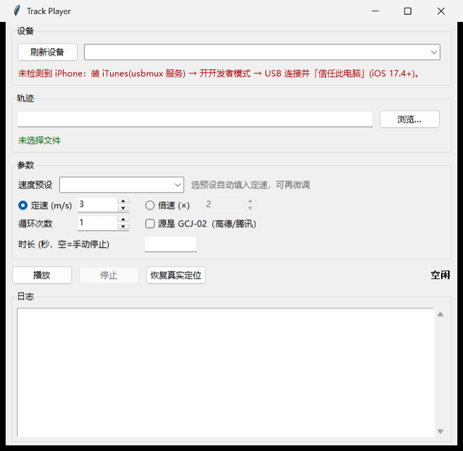

# Track Player


在 **Windows** 上让 **iPhone 真机**沿指定 GPX/KML 轨迹移动定位，用于测试自研 App 的轨迹渲染/记录效果。**无需 Mac、无需越狱、无需修改 App 代码。**

原理：[pymobiledevice3](https://github.com/doronz88/pymobiledevice3) 通过苹果官方 DVT `LocationSimulation` 调试接口向设备注入 GPS 坐标（全设备生效）。本仓库直接 import 它并**持有常开定位通道 + keep-alive**（播放期间通道不关闭、周期性重发当前坐标，抑制 iOS 融合定位回弹），在其上封装了 **Web 地图界面 `trackplayer web`（首选）**、图形界面 `trackplayer-gui` 与统一命令 `trackplayer`：一个网页（或一个窗口 / 一条命令）完成「轨迹预处理 → 检测设备 → 播放 → 退出自动恢复真实定位」，无需手动拼接多个命令。

> **pip 分发，无 exe**：`pip install git+https://github.com/Mingle180/Track-Player.git` 即装即用（未上架 PyPI），不做 PyInstaller/exe 打包，因此没有 SmartScreen / 杀软误报问题。

## 功能

**`trackplayer web`（浏览器地图界面，首选）**

```bash
trackplayer web    # 起本地服务并自动打开浏览器（默认 http://127.0.0.1:8799）
```

本地起一个网页（仅绑定 `127.0.0.1`），在 **高德底图（GCJ-02）** 上画出轨迹线，播放时**实时蓝点沿轨迹移动**并显示进度与当前坐标，便于直观核对轨迹与底图/自研 App 的对齐。设备选择、上传轨迹（GPX/KML/GeoJSON）、**地图手绘轨迹**、速度预设、播放/**暂停**/停止/恢复定位都在网页里完成，与 GUI/CLI 共用同一播放核心。注入仍用 WGS-84，显示时自动转 GCJ-02 贴合高德底图。纯标准库实现（`http.server` + SSE），地图用 CDN 上的 Leaflet，**无需 API key、无额外 Python 依赖、不依赖 tkinter**。

**`trackplayer-gui`（图形界面，窗口操作）**

一个窗口搞定：刷新/选择设备 → 选轨迹文件（GPX/KML/GeoJSON，自动显示点数/里程/时长摘要）→ 设速度（**预设步行/跑步/骑行/驾车**或自定义）/倍速/循环/坐标系/时长 → 播放/**暂停**/停止 → 实时日志（含设备坐标）→ 退出自动恢复真实定位。暂停时冻结当前坐标并保持通道（抗回弹），「继续」从暂停点恢复。播放中直接关窗也会先停止并恢复，不留残留模拟。



**`trackplayer`（命令行，一条命令搞定）**

```bash
trackplayer play route.kml --speed 3 --repeat 2   # 预处理 + 检测 iPhone + 播放，回车停止并自动恢复
trackplayer devices                               # 列出已连接设备
trackplayer clear                                 # 立即恢复真实定位
```

- 自动检测已连接 iPhone（多设备用 `--udid` 指定）
- 自动预处理（GPX/KML 解析、变速、循环、坐标系转换）后播放
- **退出时自动 `clear` 恢复真实定位**（Ctrl+C / 到时 / 播完都恢复），临时文件自动清理
- `--duration <秒>`：到时自动停止并恢复，适合无人值守

**`trackprep.py`（底层预处理核心，纯 Python 标准库，无第三方依赖）** 把 GPX/KML 统一转成「带 1 Hz 时间戳的标准 WGS-84 GPX」：

- 解析 GPX（`trkpt`/`rtept`）、KML（`LineString`、`gx:Track`）与 GeoJSON（`LineString`/`MultiLineString`/`Point`/`FeatureCollection`，后缀 `.geojson`/`.json`）
- `--speed <m/s>`：按固定速度沿轨迹插值，每秒一个点（跑步 3、骑车 5）
- `--scale <倍数>`：相对原始时间戳加速（2 = 两倍速）
- `--repeat N`：轨迹重复 N 遍
- `--from-gcj02`：GCJ-02 源（高德/腾讯导出）转回 WGS-84
- `-o out.gpx`：输出并打印点数 / 里程 / 播放时长

`trackplayer` 内部复用 `trackprep`，也可单独用 `trackprep.py` + pymobiledevice3 官方命令（见下）。

## 环境要求

- Windows 10/11
- **iTunes**（提供 Apple Mobile Device Support / usbmux 服务，pymobiledevice3 在 Windows 依赖它识别 USB 设备）—— 苹果官网下载
- Python 3.10+（实测 3.14）；**Web UI（首选）仅需标准库**，图形界面另需 **tkinter**——python.org 的 Windows 安装包自带 tcl/tk，极简发行版若缺 tkinter 只影响 GUI（Web / CLI 不受影响）
- iPhone：开启**开发者模式**（设置 → 隐私与安全性 → 开发者模式 → 打开 → 重启确认），USB 连接并「信任此电脑」
- **iOS 17.4+**：自动建立免管理员 userspace 隧道，无需 tunneld / Xcode
  - iOS 17.0–17.3 在 Windows 需管理员 tunneld + 第三方驱动；iOS ≤16 走旧命令 `developer simulate-location` + `mounter auto-mount`（详见 pymobiledevice3 文档）

## 安装

**未上架 PyPI**，从 GitHub 安装（或从源码）：

```bash
python -m venv .venv
.venv\Scripts\activate
pip install git+https://github.com/Mingle180/Track-Player.git   # 装好即有 trackplayer / trackplayer-gui / trackplayer-web 命令（自动带上 pymobiledevice3 依赖）
```

Web UI 与 GUI 随包一起装，无需额外依赖（Web 仅标准库 + CDN Leaflet；GUI 用标准库 tkinter）。

从源码安装（开发用）：

```bash
pip install -e .
```

## 用法

### 方式一：Web 地图界面（首选，浏览器 + 实时地图）

```bash
trackplayer web                 # 起本地服务并自动打开浏览器（默认 http://127.0.0.1:8799）
trackplayer web --port 8801     # 端口被占用时换一个
trackplayer web --no-open       # 只起服务，不自动开浏览器
# 等价独立命令：trackplayer-web
```

若提示「找不到命令」（Python 的 Scripts 目录未进 PATH），用不依赖 PATH 的兜底写法：

```bash
python -m trackplayer_web
```

网页操作流：

1. **设备**：启动自动检测，下拉选 iPhone（无设备给引导文案）。
2. **轨迹**：点「选择文件」上传 `.gpx`/`.kml`/`.geojson`/`.json`，地图立即画出轨迹线（GCJ-02，贴合高德底图）并显示点数/里程/时长摘要；或点「画轨迹」在地图上逐点点击手绘路线（GCJ-02），「撤销点」回退、「用绘制轨迹」生成 GPX 并预览。
3. **参数**：速度预设（步行/跑步/骑行/驾车）或自定义定速/倍速、循环、时长、「源是 GCJ-02」开关、「地图跟随蓝点」。
4. **播放**：点「播放」，蓝点沿轨迹实时移动，状态栏显示进度（已注入/总点数）与当前坐标，日志区实时刷新；「暂停」冻结蓝点（保持通道抗回弹）、「继续」恢复；「停止」提前结束，「恢复定位」立即还原。
5. **自动恢复**：停止 / 到时 / 播完都会自动恢复真实定位。

说明：

- 服务**仅绑定本机 `127.0.0.1`**，不暴露到局域网；Ctrl+C 退出服务。
- 地图底图用高德栅格瓦片、Leaflet 从 CDN 加载，**首次打开需联网**；仅供开发者本地测试使用。
- 与 GUI/CLI 共用 `play_track` 核心，同一时刻只跑一个播放会话（单隧道）。

### 方式二：图形界面（窗口操作）

```bash
trackplayer-gui        # 或等价命令：trackplayer gui
```

若提示「找不到命令」，同样可用兜底写法：

```bash
python -m trackplayer_gui
```

操作流：

1. **设备**：启动自动刷新；点「刷新设备」重新检测，下拉框选目标 iPhone（无设备时窗口给出引导文案）。
2. **轨迹**：点「浏览…」选 `.gpx`/`.kml`/`.geojson`/`.json`，下方即时显示点数 / 里程 / 播放时长摘要。
3. **参数**：先用「速度预设」下拉（步行/跑步/骑行/驾车，自动换算 m/s）或「自定义」；定速 (m/s) 或倍速 (×) 二选一；循环次数；「源是 GCJ-02（高德/腾讯）」开关；时长（秒，留空=手动停止）。
4. **播放/暂停/停止**：点「播放」，日志区实时显示注入坐标与 pymobiledevice3 日志；点「暂停」冻结当前坐标（保持通道抗回弹），「继续」从暂停点恢复；点「停止」提前结束。
5. **自动恢复**：停止 / 到时 / 播完 / 关窗都会自动 `clear` 恢复真实定位；也可随时点「恢复真实定位」。

### 方式三：trackplayer 命令行

```bash
trackplayer play route.kml --speed 3 --repeat 2     # 预处理 + 播放，按回车停止并自动恢复
trackplayer play route.gpx --preset 跑步            # 用配置里的速度预设（km/h 自动换算 m/s）
trackplayer play amap_track.gpx --from-gcj02 --speed 3
trackplayer play route.gpx --duration 120           # 播放 120 秒后自动停止并恢复
trackplayer devices                                 # 列出已连接设备（含 UDID）
trackplayer clear                                   # 立即恢复真实定位
```

`play` 选项：`--speed`/`--scale`/`--preset`（三选一）、`--repeat N`、`--from-gcj02`、`--duration 秒`、`--udid <UDID>`、`-o out.gpx`（保留预处理结果）。输入支持 `.gpx`/`.kml`/`.geojson`/`.json`。多设备时必须用 `--udid` 指定。交互模式下**回车停止**、**`p`+回车 暂停/继续**（暂停冻结坐标并保持通道，`--duration` 时钟同步冻结）。

### 方式四：trackprep + 官方命令（手动）

**1. 预处理**

```bash
python trackprep.py route.kml -o route_play.gpx --speed 3 --repeat 2
python trackprep.py amap_track.gpx -o out.gpx --from-gcj02 --speed 3
```

**2. 播放**（保持 USB 连接与进程运行）

```bash
pymobiledevice3 developer dvt simulate-location play route_play.gpx
```

后台运行时**必须保持 stdin 打开**，否则进程读到 EOF 立即退出、模拟失效：

```bash
sleep 2400 | pymobiledevice3 developer dvt simulate-location play route_play.gpx
```

**3. 恢复真实定位**

```bash
pymobiledevice3 developer dvt simulate-location clear
```

多设备时给 pymobiledevice3 命令加 `--udid <UDID>`。

## 配置（可选）

内置默认配置可被用户文件 `~/.trackplayer/config.json`（Windows：`C:\Users\<你>\.trackplayer\config.json`）覆盖，Web 刷新页面（F5）、GUI 点「刷新设备」即热加载，无需重启：

```json
{
  "speed_presets": [
    {"label": "步行", "kmh": 5},
    {"label": "跑步", "kmh": 10},
    {"label": "骑行", "kmh": 20},
    {"label": "驾车", "kmh": 50}
  ],
  "default_speed_mps": 3.0,
  "default_scale": 2.0,
  "default_repeat": 1,
  "keepalive_interval_s": 1.0
}
```

- `speed_presets`：Web/GUI 下拉与 `--preset` 用的速度预设（km/h，自动换算 m/s）。
- `default_*`：Web/GUI 参数初始值。
- `keepalive_interval_s`：播完持有末点时重发坐标的间隔（抗回弹）。
- 只需写你想改的键，其余沿用默认；文件缺失/损坏自动回退内置默认。

## 坐标系（重要）

- **注入文件始终用 WGS-84。**
- 若 App 使用**高德/腾讯 SDK**：国内（含港澳台）SDK 返回 GCJ-02，会自动给注入的 WGS-84 加偏，在高德底图上显示正确；海外原样返回 WGS-84。
- 若**轨迹源本身是 GCJ-02**（高德/腾讯导出），先用 `--from-gcj02` 转回 WGS-84，否则双重偏移约 500 m。
- 标准 GPX（WGS-84）无需转换。

## 常见问题

更多问题与排障见 **[FAQ.md](FAQ.md)**。

- **蓝点不动 / 回弹**（iOS 27 系统 Wi-Fi/基站融合定位纠偏）：本工具已用常开通道 + keep-alive 抑制回弹；若仍回弹，开飞行模式 10 秒再关 + 彻底重启目标 App；备用：直接关 Wi-Fi。
- 模拟**只替换 GPS 坐标**，不模拟计步器 / 运动传感器；若 App 融合步频判断运动状态需注意。
- 模拟期间**全设备**定位都被替换；用 Web / GUI / `trackplayer` 退出会自动恢复，手动方式结束后需 `clear`；异常时**重启手机必恢复**。
- 播放期间断开 USB / Ctrl+C 后模拟失效。

## 示例

- `examples/pku54_loop.gpx`：北京大学五四操场 400 m 环线（国内 GCJ-02 对齐验证用），`examples/generate_pku54.py` 可复现该几何。
- `examples/whitehouse_run.py`：白宫环线生成器（海外 WGS-84 示例），运行后生成 `whitehouse_run.gpx/.kml`。

```bash
trackplayer web    # 首选：网页里上传 examples/pku54_loop.gpx，定速 5 m/s、循环 3 后播放
# 或命令行：
trackplayer play examples/pku54_loop.gpx --speed 5 --repeat 3
# 或手动：
python trackprep.py examples/pku54_loop.gpx -o pku.play.gpx --speed 5 --repeat 3
pymobiledevice3 developer dvt simulate-location play pku.play.gpx
```

## 用途声明

本工具仅供开发者在**自有设备 / 自有 App** 上做定位轨迹测试。请遵守当地法规与苹果开发者条款，勿用于作弊、欺诈或侵犯他人权益。

## 许可

- 本仓库代码（`trackplayer.py`、`trackplayer_gui.py`、`trackplayer_web.py`、`trackplayer_config.py`、`trackprep.py`）及文档：**GPL-3.0-or-later**（见 [LICENSE](LICENSE)）。
- 核心直接 import [pymobiledevice3](https://github.com/doronz88/pymobiledevice3)（**GPL-3.0**）以持有常开 DVT 定位通道，本工具构成其衍生作品，故整体以 GPL-3.0 分发。设备列表仍以子进程调用其 CLI（`usbmux list`）。

## 参考

- pymobiledevice3 CLI 用法：https://doronz88.github.io/pymobiledevice3/latest/guides/cli-recipes/
- iOS 17+ 隧道机制：https://doronz88.github.io/pymobiledevice3/latest/guides/ios17-tunnels/
- 命令参数：https://doronz88.github.io/pymobiledevice3/latest/cli/developer/